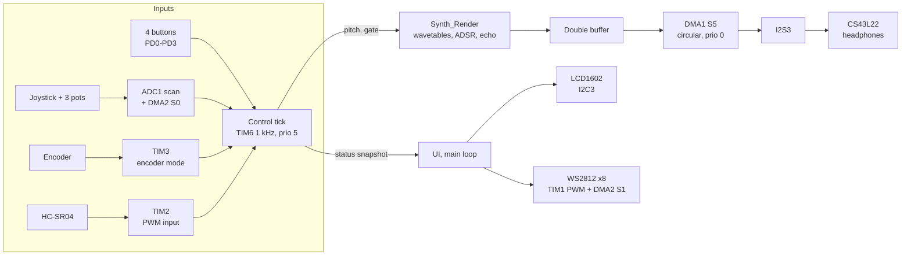

# PocketSynth

A handheld, 4-voice polyphonic synthesizer on the **STM32F407G-DISC1** (Cortex-M4F, 168 MHz), written in C with STM32 HAL and CubeMX.
Audio comes out of the board's own **CS43L22** DAC and headphone jack, streamed over **I2S + circular DMA** at 48 kHz.
On top of the keyboard there is an ultrasonic **theremin mode**, a 16x2 LCD status screen and an 8-LED level meter.

<!-- Demo video: add link here -->
<!-- Photo: add docs/pocketsynth.jpg here -->

## Features

| | |
|---|---|
| **Sound** | 4 wavetable voices (sine, square, saw, triangle), per-voice ADSR envelope, 341 ms feedback echo |
| **Keyboard** | 4 note buttons (C major chord), debounced in software, any combination plays at once |
| **Expression** | Joystick X = pitch bend (+/-2 semitones), Y = vibrato depth (5.5 Hz), press = octave shift |
| **Knobs** | Rotary encoder = waveform; 3 pots = attack (2 ms-2 s), release (10 ms-3 s), echo amount |
| **Theremin** | Blue button toggles it: hand distance 5-50 cm over an HC-SR04 sets the pitch across 2 octaves, with glide |
| **Display** | LCD1602 shows mode, waveform, octave and knob values (or hand distance and note name) |
| **LEDs** | 8 WS2812 RGB LEDs: level meter in keyboard mode, blue-to-red distance bar in theremin mode |

## Measured performance

Measured on the board with the Cortex-M4 **DWT cycle counter** (`perf.c`), Debug build at `-O2`, 168 MHz.

| What | Result | Budget |
|---|---|---|
| Audio render, idle (echo running) | 22,034 cycles = **4.9 %** CPU | 448,084 cycles per 128-frame block (2.67 ms) |
| Audio render, all 4 voices | 34,828 cycles = **7.8 %** CPU (worst seen 8.3 %) | same |
| Control tick (buttons, ADC, pitch, theremin) | **1.6 %** average, 1.9 % worst (19 us) | 168,000 cycles per 1 ms tick |
| NoteOn to first rendered sample | **1.1 ms** average, 2.5 ms worst (41 presses) | |
| Key press to DAC, software path | about **3.8 ms** average (render wait + one 2.67 ms buffer) | |
| Key press to DAC, including the 5 ms debounce | about **9 ms** average | |

* **Compiler optimisation matters:** the same render took 79,160 cycles (17.7 %) at `-O0`. Switching to `-O2` made it **3.6x faster** and cut code size from 48.6 KB to 34.5 KB.
* The tick's timing subtracts any time the audio interrupt preempted it. Without that, the "worst case" read a misleading 50 %, which was really one tick plus one audio render.
* Everything that runs in interrupts together uses under 10 % of the CPU, leaving the rest to the main loop (LCD and LEDs).

## How it works



**Real-time structure.** The design rule is that each job runs at the lowest priority it can afford, and nothing slow runs in an interrupt.

| Job | Runs in | NVIC priority | Rate |
|---|---|---|---|
| Audio render (`Synth_Render`) | I2S DMA half/full-transfer interrupt | **0** (highest) | every 2.67 ms |
| Control tick (`controls.c`) | TIM6 update interrupt | 5 | 1 kHz |
| ADC results | DMA2 Stream0, interrupts **disabled** (the tick just reads the buffer) | - | continuous |
| LED frame finished | DMA2 Stream1 interrupt | 7 | 50 Hz |
| LCD and LED drawing (`ui.c`) | main loop, scheduled with `HAL_GetTick` | none | 10 Hz / 50 Hz |
| HAL tick | SysTick | 15 (lowest) | 1 kHz |

**Audio path.** The I2S DMA plays a 2 x 128-frame circular buffer. When one half finishes, its interrupt renders the next 128 frames into it while the other half plays. The control tick only writes each voice's `phase_inc` and `gate`; the audio interrupt owns the envelopes. The sample rate is the real I2S rate, 86 MHz / (256 x 7) = **47,991 Hz**, so notes stay in tune.

**Synth engine.** Each voice is a 32-bit phase accumulator indexing a 1024-entry wavetable (`phase >> 22`). Pitch bend, vibrato and octave are all added in semitones and turned into one frequency ratio with a single `powf` per tick. The echo is a 16,384-sample `int16_t` ring buffer placed in the 64 KB **CCM RAM**, keeping it out of the main SRAM that DMA uses.

**Theremin.** TIM9 sends a 10 us trigger pulse every 60 ms entirely in hardware. TIM2 in PWM-input mode resets on the echo's rising edge and captures the falling edge into CCR2, so the register holds the echo time in microseconds (58 us per cm). The tick polls the capture flag, glides the pitch toward the new target, and goes silent after 200 ms without a reading.

**LEDs.** WS2812s are timed by pulse width: 1.25 us per bit, 0.4 us high for a 0 and 0.8 us high for a 1. TIM1 runs a 210-tick (1.25 us) PWM and the DMA feeds a new compare value for each of the 192 bits, so a whole frame goes out with no CPU involvement.

**LCD.** The PCF8574 I2C backpack drives the HD44780 in 4-bit mode. The driver finds whichever I2C address answers, and only re-sends a line when its text changed.

## Hardware

* STM32F407G-DISC1 Discovery board (onboard CS43L22 DAC, headphone jack, ST-LINK)
* 4 push buttons, analog joystick module with push switch, 3 x 10 kOhm potentiometers, rotary encoder
* HC-SR04 ultrasonic sensor, 3 x 1 kOhm resistors (voltage divider)
* LCD1602 with PCF8574 I2C backpack
* 8-LED WS2812 module, 220 Ohm resistor
* Two breadboards (one on 3 V, one on 5 V) with their GND rails joined

## Wiring

**3 V side** (everything the ADC reads must stay at or below 3.3 V)

| Part | Pin | Board pin | Peripheral |
|---|---|---|---|
| Note buttons 1-4 (other leg to GND) | | PD0, PD1, PD2, PD3 | GPIO input, internal pull-up |
| Joystick | VRx / VRy | PB0 / PB1 | ADC1_IN8 / ADC1_IN9 |
| Joystick | SW | PD6 | GPIO input, internal pull-up |
| Joystick | VCC | **3V** | |
| Attack / release / echo pot wipers | | PA1 / PA2 / PA3 | ADC1_IN1 / IN2 / IN3 |
| Encoder | CLK / DT | PB4 / PB5 | TIM3_CH1 / TIM3_CH2 (encoder mode) |
| Encoder | + | 3V | |

**5 V side**

| Part | Pin | Board pin | Peripheral |
|---|---|---|---|
| HC-SR04 | VCC | 5V | |
| HC-SR04 | Trig | PE5 | TIM9_CH1 (PWM) |
| HC-SR04 | Echo | 1 kOhm to PA15, 2 kOhm from PA15 to GND | TIM2_CH1 (PWM input) |
| LCD backpack | VCC / SDA / SCL | 5V / PC9 / PA8 | I2C3 |
| WS2812 module (IN side) | V / S | 5V / 220 Ohm to PE9 | TIM1_CH1 (PWM + DMA) |

All GND pins and both breadboards' GND rails are connected together. PA8 and PC9 are 5 V tolerant, so the backpack's 5 V pull-ups are safe there, which is also why the LCD has its own I2C bus instead of sharing the codec's.

**Onboard, no wiring:** CS43L22 (I2C1 PB6/PB9 at 0x94, I2S3 PA4/PC7/PC10/PC12, reset PD4), blue user button PA0 (mode), and LEDs PD12-PD15, which light while the matching note button is held.

## Building and flashing

1. Open the project folder in **STM32CubeIDE** (1.19 used here). `PocketSynth.ioc` holds all pin and peripheral settings.
2. Build the **Debug** configuration (set to `-O2`), then Run or Debug with the board connected through its **mini-USB ST-LINK** port.
3. Optional: in a debug session, add `perf` to *Live Expressions* to watch CPU load and latency update in real time.

Command-line flash with STM32CubeProgrammer:

```
STM32_Programmer_CLI -c port=SWD -w Debug/PocketSynth.elf -v -rst
```

## Code tour

| File | What it does |
|---|---|
| `Core/Src/main.c` | Starts everything in order: codec, audio DMA, sensor, controls, UI; main loop runs the UI |
| `Core/Src/cs43l22.c` | Codec setup over I2C1: power sequencing, headphone output, volume |
| `Core/Src/audio.c` | I2S circular DMA double buffer; calls the synth from the half/full callbacks |
| `Core/Src/synth.c` | Wavetables, 4 voices, ADSR, mixing, clipping, output peak for the meter |
| `Core/Src/echo.c` | Feedback delay line in CCM RAM |
| `Core/Src/controls.c` | 1 kHz tick: debouncing, encoder, ADC smoothing, bend/vibrato/octave, theremin |
| `Core/Src/sonar.c` | HC-SR04 driver on TIM9 (trigger) and TIM2 (echo capture) |
| `Core/Src/lcd.c` | HD44780 over a PCF8574 I2C backpack |
| `Core/Src/leds.c` | WS2812 driver on TIM1 PWM + DMA |
| `Core/Src/ui.c` | What the LCD and LEDs show, on their own schedules |
| `Core/Src/perf.c` | DWT cycle-counter measurements |

Peripheral setup (`adc.c`, `dma.c`, `i2c.c`, `i2s.c`, `tim.c`, `gpio.c`) is generated by CubeMX; hand-written code lives in the `USER CODE` sections and in the files above.

## Debugging notes

* **Buttons that only worked on one side of the breadboard.** A button straddling the centre gap connects its legs across the gap, so wiring the pin and GND to opposite sides shorted them. Reading the GPIO input register live over SWD showed which pins were stuck low.
* **LCD not answering.** Live reads of I2C3's status register and the GPIO input registers showed the clock line held low mid-transfer. Only the master drives SCL, so the SCL wire had to be somewhere other than PA8. It was on PC8, one row down on the header.
* **A misleading worst case.** The control tick's maximum time first read 50 % because the audio interrupt (priority 0) preempted it mid-tick. Subtracting the audio time that elapsed during the tick gave the real figure, 1.9 %.
